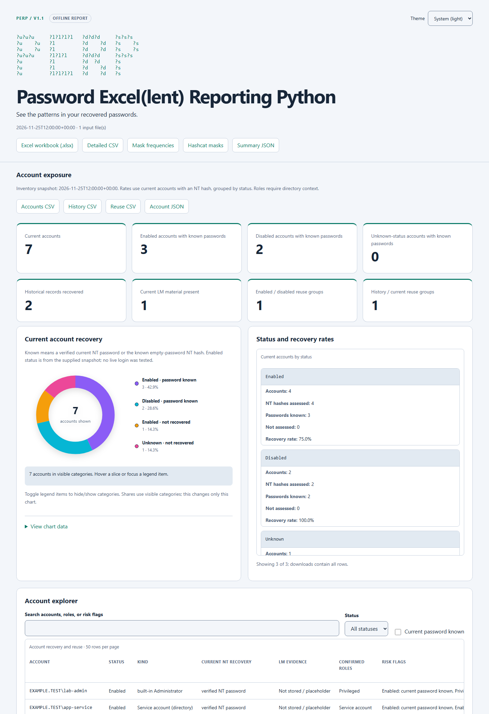
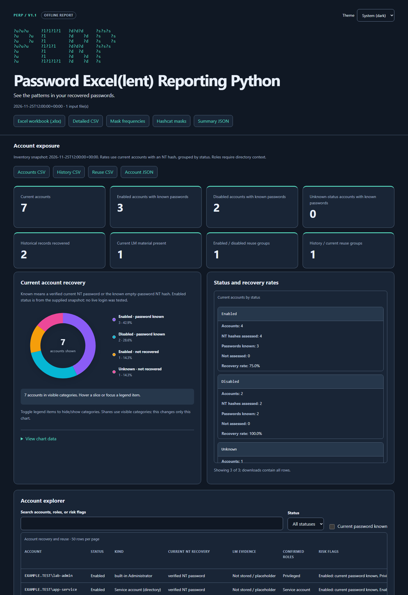
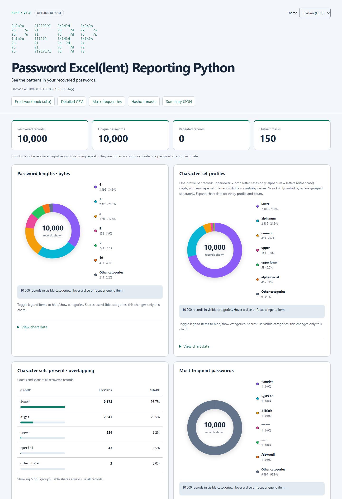
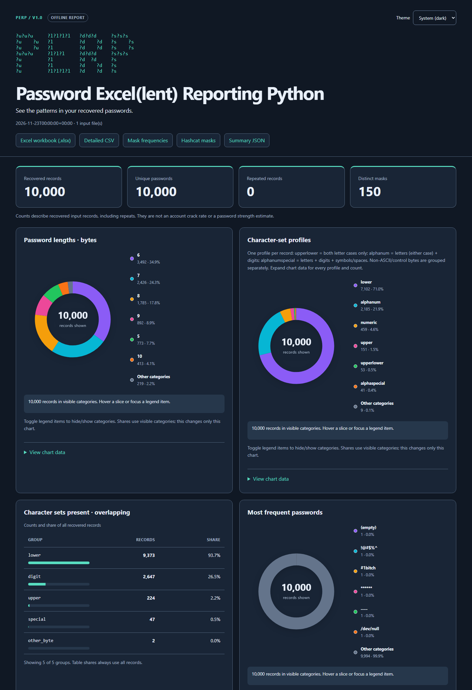

# 🔐 Password Excel(lent) Reporting Python

**Cracked passwords. Clear patterns. Colourful reports.**

perp (Password Excel(lent) Reporting Python) is a tool for extracting information
from hashcat or john potfiles and generates a dashboard report (exportable to Excel),
providing a holistic and eye catching visual representation of cracked passwords and
patterns contained in them. Plaintext password lists are supported too.

[🚀 Quick start](#quick-start) · [⚙️ Options](#options) · [📊 Screenshots](#see-it-in-action) · [🔗 AttackForge](#attackforge) · [📜 History](#history)

## Release 1.1

Account-aware password reporting, offline on Linux, macOS, and Windows.
Requires Python 3.10+; Excel export remains optional.

- 📊 **Measure exposure:** enabled, disabled, and unknown-status account recovery, with current/history separation.
- 🔎 **Find reuse:** shared current credentials, disabled-to-enabled links, and historical-to-current matches.
- 📁 **Keep the evidence:** LM-half tracking, confirmed directory roles, CSV/JSON exports, and account sheets in Excel.
- 🔗 **Continue the assessment:** explicit candidate-seed exports and account-aware AttackForge drafts.
- 🎨 **Explore the patterns:** interactive offline charts, record search, light/dark themes, and Hashcat masks.

[Full changelog](CHANGELOG.md)

## Quick start

Clone this repository and run:

```bash
git clone https://github.com/brokendata/perp.git
cd perp
python3 ./perp.py ./hashcat.potfile --format hashcat --output-root ./reports
```

Open `password_report.html` in the new `results-*` folder. Standard reports need
no additional Python packages, server, or internet connection.
On Windows, use `python` instead of `python3`.

## Installation

### Kali Linux

Prefer **apt** for Kali's externally managed Python environment:

```bash
sudo apt update
sudo apt install python3
# Optional Excel export
sudo apt install python3-xlsxwriter
```

Avoid global pip installs. See [Kali's Python package guidance](https://www.kali.org/docs/general-use/python3-external-packages/).

### macOS

Use an existing Python 3.10+ installation, or install Python with [Homebrew](https://brew.sh/):

```bash
brew install python
```

For Excel export, use the virtual environment below.

### Windows

Use Python 3.10+ and run commands with `python`. For Excel export:

```text
python -m venv .venv
.venv\Scripts\python.exe -m pip install -r requirements-excel.txt
.venv\Scripts\python.exe ./perp.py ./hashcat.potfile --format hashcat --excel
```

### Optional Excel dependency — Linux / macOS

If you are not using Kali's apt package, install XlsxWriter in a virtual environment.
On Kali, install `python3-venv` with apt first.

```bash
python3 -m venv .venv
.venv/bin/python -m pip install -r requirements-excel.txt
.venv/bin/python ./perp.py ./hashcat.potfile --format hashcat --excel
```

Use that environment's interpreter for subsequent commands. Microsoft Excel is
not required to generate workbooks.

Use **pip inside the virtual environment** here: XlsxWriter is an imported
library. [pipx installs command-line applications](https://pipx.pypa.io/stable/explanation/comparisons.html)
in separate environments, so installing XlsxWriter with pipx would not make it
available to perp.

## Usage

```bash
# Multiple files
python3 ./perp.py ./hashcat.potfile ./john.pot

# Scan a directory, including subdirectories
python3 ./perp.py ./inputs --recursive --output-root ./reports

# Match files with a quoted wildcard
python3 ./perp.py "./inputs/*.pot*"

# Plaintext wordlist
python3 ./perp.py /path/to/rockyou.txt --format plaintext --encoding latin-1

# Add an Excel workbook
python3 ./perp.py ./hashcat.potfile --format hashcat --excel

# Label bare NTLM digests when the cracking job's type is known
python3 ./perp.py ./ntlm.potfile --format hashcat --hash-type NTLM
```

RockYou is available separately; see [External wordlists](WORDLISTS.md).

## Account inventory workflow

Provide a complete **NTDS/secretsdump text export** as the baseline, then add
potfiles or recovered-password lists. The inventory supplies names, LM/NT fields,
status, and optional history; passwords are verified offline against NT hashes.
Binary `NTDS.dit` requires separate extraction.

```bash
# Inventory-only overview
python3 ./perp.py --inventory /path/to/accounts.ntds --output-root ./reports

# Correlate recoveries, with optional directory metadata
python3 ./perp.py ./hashcat.potfile --format hashcat --inventory /path/to/accounts.ntds --directory-context ./directory.csv --excel --attackforge

# Hashcat's default username:hash:password show export
python3 ./perp.py ./show.txt --format hashcat-show --inventory /path/to/accounts.ntds

# Explicitly export deduplicated seeds for a further recovery round
python3 ./perp.py ./hashcat.potfile --inventory /path/to/accounts.ntds --export-seeds
```

For the best results, include enabled/disabled status, a snapshot timestamp, and
directory metadata confirming roles, ownership, and password age. Missing status
stays Unknown. History overlaps and LM halves do not inflate current NT recovery.
Seed exports can include partial LM components; they are not all verified current
passwords, and no cracking tool is launched.

[Input formats, directory CSV, and correlation rules](docs/account-inventory.md) ·
[Synthetic v1.1 account dashboard](sample/account-risk/README.md)

## Options

```text
python3 perp.py INPUT [INPUT ...] [OPTIONS]
```

| Argument / option | Purpose | Default |
| --- | --- | --- |
| `INPUT [INPUT ...]` | Recovery files, directories, or quoted wildcard patterns. | Required unless `--inventory` is supplied |
| `-r`, `--recursive` | Include subdirectories when scanning directories. | Off |
| `-o PATH`, `--output-root PATH` | Create a new timestamped result folder under this path. | Current directory |
| `--format FORMAT` | Input dialect: `auto`, `plaintext`, `potfile`, `hashcat`, `john`, or `hashcat-show`. | `auto` |
| `--inventory FILE` | NTDS/secretsdump text inventory; repeatable. | None |
| `--inventory-domain DOMAIN` | Domain scope for unqualified inventory names. | Separate scope per file |
| `--directory-context CSV` | Confirmed account roles, status, assets, owners, and timestamps, joined by domain/RID. | None |
| `--snapshot-time ISO` | Inventory snapshot timestamp with timezone; enables password-age calculation. | Unknown |
| `--export-seeds` | Write sensitive local candidate seeds; requires `--inventory`. | Off |
| `--hash-type TYPE` | Label otherwise unidentified potfile hashes, e.g. `NTLM`, `LM`, `MD5`, or any custom name. Recognized signatures and plaintext are unchanged. | `auto` |
| `--encoding NAME` | Input text/display encoding, such as `utf-8`, `latin-1`, or `cp1252`. | `utf-8` |
| `--separator TEXT` | Delimiter between potfile fields. | `:` |
| `--password-field N` | Treat everything after the Nth separator as the password. | Format-aware parsing |
| `--excel` | Add an XLSX workbook; requires XlsxWriter. | Off |
| `--attackforge` | Prepare a local AttackForge review bundle. | Off |
| `--account-context CSV` | Map source records to confirmed accounts, assets, and roles; requires `--attackforge`. | None |
| `--evidence IMAGE` | Attach a PNG, JPEG, or WebP for review; repeatable, requires `--attackforge`. | None |
| `--version` | Print the version and exit. | — |
| `-h`, `--help` | Show command-line help and exit. | — |

### Choosing an input format

| Format | Use it for |
| --- | --- |
| `auto` | `.pot` / `.potfile` files use conservative potfile parsing; other extensions are plaintext. |
| `plaintext` | One literal password per line, preserving spaces, colons, and empty passwords. |
| `potfile` | Recognized Kerberos and NetNTLM layouts, or unambiguous `hash:password` records. |
| `hashcat` | Canonical Hashcat potfiles, including internal hash separators and `$HEX[]` passwords. |
| `john` | John potfiles supported by the conservative parser; custom layouts need an explicit override. |
| `hashcat-show` | Default `--show --username` export, with username prefix and hash/password output. |

Ambiguous multi-field records fail rather than guessing. Use `hashcat` only for
genuine potfiles, not arbitrary `--show` exports. For a known `hash:salt:password`
layout, `--password-field 2` selects everything after the second separator.
Normalize exports with trailing metadata before processing them.

Directory scans select `.txt`, `.pot`, and `.potfile` inputs and skip previous
`results-*` folders and known output text files. Explicit paths accept any extension.
Use an ASCII-compatible encoding; convert UTF-16/32 input to UTF-8 first.

### Hash / credential types

The dashboard and Excel workbook include a type distribution chart and a full
count/share table. The record explorer can search by type; detailed CSV records
include `hash_type` and `hash_type_basis` (`signature`, `declared`, `inventory`,
`unknown`, or `plaintext`). Summary JSON includes `hash_types` and identification-basis counts.

Automatic recognition covers supported Kerberos and NetNTLM layouts, tagged NTLM
and LM, bcrypt, Unix crypt variants, Argon2, scrypt, PBKDF2, phpass, DCC2, and
several database/LDAP formats. The signature registry in `hash_types.py` can be
extended; it is not an exhaustive detector of every Hashcat/John format.

Bare digests stay **Unknown / ambiguous**: a 32-character hex value alone does
not distinguish NTLM, LM, MD5, or other algorithms. Use `--hash-type TYPE` when
the cracking job establishes the type. Any explicit label is supported; use
separate runs for different unknown types because the hint applies across the
run. Signature matches remain format identification, not cryptographic proof.
Plaintext lists show **Plaintext (no hash)**, including the RockYou sample.
Counts describe recovered input records, including repeated records and LM
halves, rather than accounts, full LM passwords, or an overall crack rate.

## See it in action

### Account exposure · v1.1

The [synthetic account sample](sample/account-risk/README.md) demonstrates
status-based recovery, credential reuse, LM evidence, and password history.





### Password patterns

The [sample report](sample/README.md) explores 10,000 public RockYou entries and
150 distinct masks. Download the project and open the
[HTML dashboard](sample/password_report.html) locally, or try the
[Excel workbook](sample/password_report.xlsx).

**☀️ Light**



**🌙 Dark**



Hover or focus chart legends to inspect counts, click to hide/show categories,
and use **View chart data** for the underlying figures. Character-set profiles
count one category per record; character-set presence counts overlap.

## Output files

Each run creates `results-YYYYMMDD-HHMMSS/`. Runs within the same second add a
counter (`-2`, `-3`, etc.) to keep earlier results intact.

| File | Contents |
| --- | --- |
| `password_report.html` | Interactive dashboard with embedded styles, scripts, and data. |
| `password_report.xlsx` | Optional Excel workbook with charts and filterable tables (`--excel`). |
| `passwords.csv` | Detailed records, character counts, masks, source paths, and line numbers. |
| `masks.csv` | Mask frequencies. |
| `HashcatMasks.hcmask` | Unique, nonempty Hashcat masks, ordered by frequency. |
| `HashcatMasks.txt` | Compatibility copy of the masks. |
| `summary.json` | Aggregate distributions, top passwords, and input provenance. |
| `attackforge/` | Optional review bundle and evidence (`--attackforge`). |
| `account_risk.json`, `accounts.csv` | Account exposure and provenance (`--inventory`); no raw inventory hashes. |
| `password_history.csv`, `credential_reuse.csv` | History/overlap tracking and reuse relationships (`--inventory`). |
| `candidate_seeds.txt` | Sensitive candidate material, only with `--export-seeds`. |

Masks preserve byte order: `Ab9!z` becomes `?u?l?d?s?l`. Non-ASCII/control bytes
use `?b` per byte. Counts describe input records, not total accounts or a crack rate.

Reports contain recovered passwords and source paths. Keep real audit outputs
private. Large inputs consume memory and produce large HTML files; split them
when needed. Excel exports enforce its row and cell-size limits.

## AttackForge

[AttackForge](https://attackforge.com/) is a penetration-testing management and
reporting platform. Teams use it to organize engagements and affected assets,
document vulnerabilities and evidence, produce reports, and track remediation
and retesting.

perp turns password-audit results into draft findings for that workflow:

- **LM hash storage:** recommend disabling LM storage and coordinating password
  changes to remove existing LM material.
- **Recovered privileged credentials:** recommend controlled rotation, password
  reuse review, and protection of administrative access.
- **Recovered service credentials:** recommend coordinated rotation, dependency
  updates, and managed service accounts where appropriate.

These drafts require confirmed account, asset, role, and hash-type context.
Account names alone do not establish privilege, and dictionary entries do not
establish account vulnerabilities. See the
[CSV requirements](skills/perp-attackforge/references/bundle-and-context.md).

Prepare a local bundle with optional screenshots:

```bash
python3 ./perp.py ./audit.potfile --format hashcat --attackforge --account-context ./accounts.csv --evidence ./redacted.png
```

The `attackforge/` folder contains JSON findings, a review summary, an aggregate
graphic, and supplied images. Password and hash values are omitted from the
JSON/graphic; supplied screenshots still need review for sensitive content.
The command makes no uploads.

With `--inventory`, account findings feed this bundle automatically, including
enabled-password exposure and reuse relationships. Confirmed directory roles
enable privileged/service-account drafts; unknown status and missing asset
mapping remain review checks. See the [account workflow](docs/account-inventory.md).

To publish through a consultant's connection:

1. Install the [portable skill](skills/perp-attackforge/SKILL.md) in the assistant's skill directory.
2. Invoke `$perp-attackforge` with the results folder and intended AttackForge project.
3. Review findings, severity, asset matches, and screenshots, then instruct the assistant to publish.

The skill uses the consultant's authenticated
[AttackForge MCP or API connection](https://attackforge.com/integrations) to map
findings to in-scope assets, check for duplicates, attach evidence, and verify
the published records. The JSON is an intermediate review format, not a native
AttackForge import payload. Live publication requires a connection with the
appropriate permissions.

## History

perp began as a collection of Bash and PowerShell scripts for analyzing cracked
passwords and generating Excel reports with charts and PivotTables. Version 1.0
brings those ideas together in a Python tool that runs on Linux, macOS, and
Windows, adding interactive HTML dashboards, light and dark themes, broader
input support, hash-type reporting, and AttackForge export workflows while
retaining optional Excel output.

## Development

```bash
python3 -m unittest discover -s tests -v
```

[Changelog](CHANGELOG.md) · [Sample files](sample/README.md) · [External wordlists](WORDLISTS.md)

